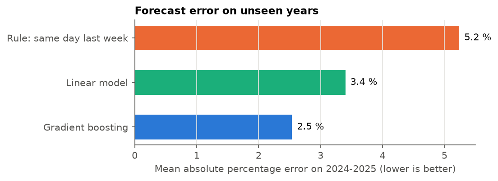
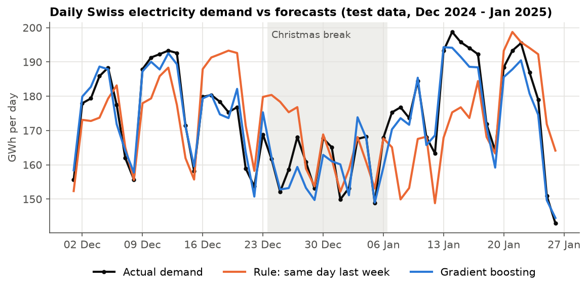
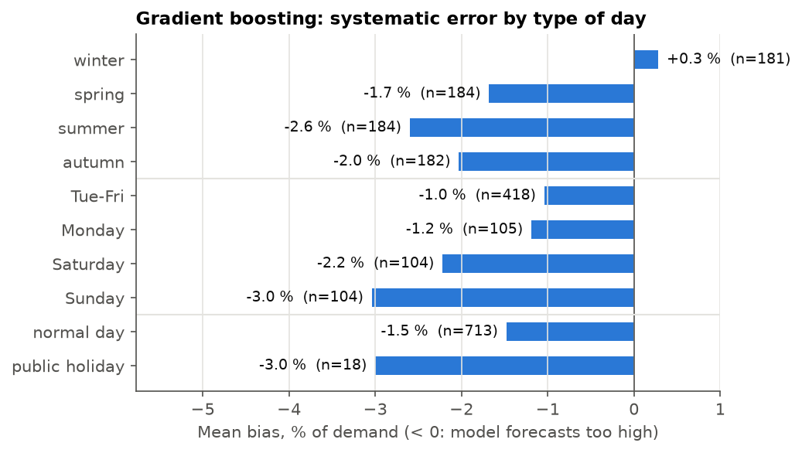
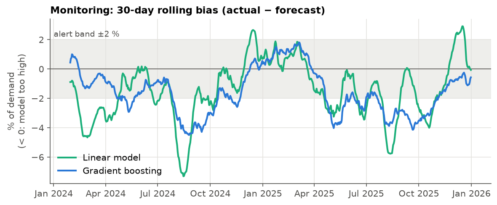
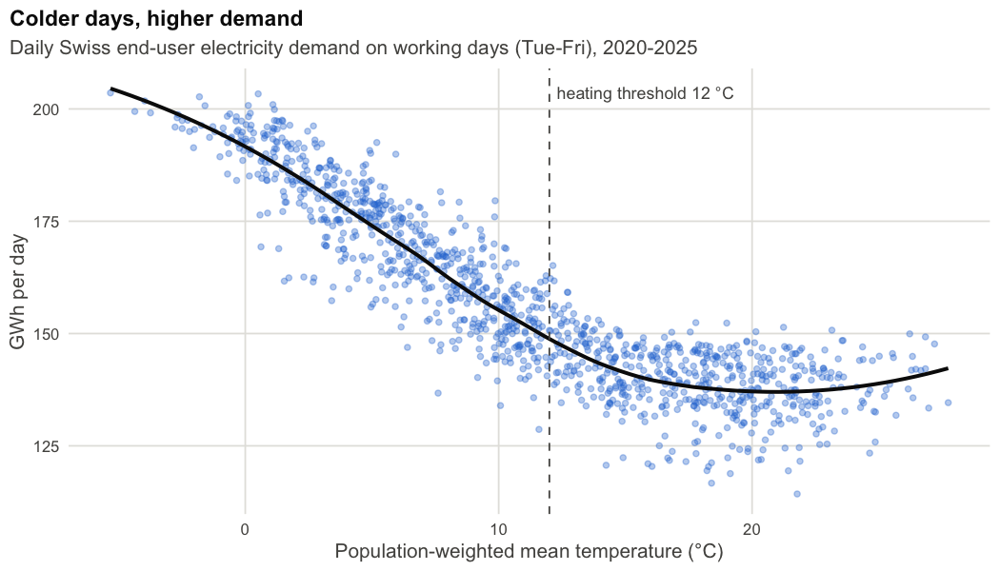
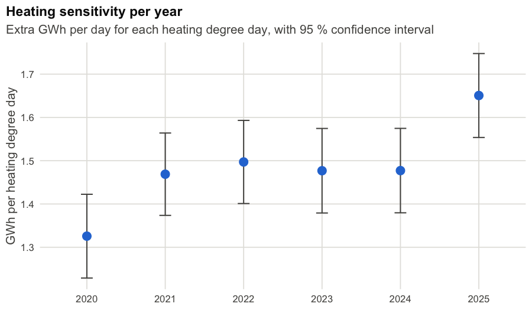
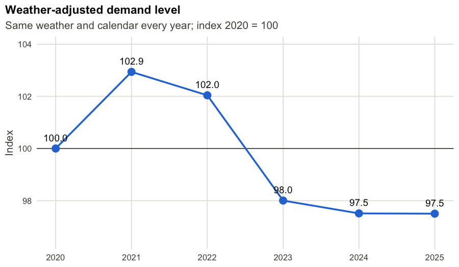

# Swiss Power Demand Model

**How much does weather drive Swiss electricity demand, can a statistical model forecast it better than a simple rule, and where does it go wrong?**

Daily end-user electricity demand in Switzerland (Swissgrid, 2020–2025) combined with population-weighted weather for six cities. Three forecasting approaches are trained on 2020–2023 and tested on **2024–2025, which the models never see during training**. Their errors are then checked for systematic bias and drift. An interpretable regression in R measures the temperature effect and how it changes over time.

Python handles the data pipeline, the forecasting models and the error analysis. R handles the interpretable regression and its charts.

## Key findings

**1. A statistical model halves the error of a simple rule.** The rule "demand will be the same as on the same weekday last week" misses by 5.2 % on average. A linear model with weather and calendar effects misses by 3.4 %, and gradient boosting by 2.5 %.

| Model (test data 2024–2025) | MAE (GWh/day) | MAPE | Bias |
|---|---:|---:|---:|
| Rule: same day last week | 7.75 | 5.2 % | −0.2 % |
| Linear model | 4.83 | 3.4 % | −1.4 % |
| Gradient boosting | 3.51 | 2.5 % | −1.5 % |



**2. The rule fails exactly when it matters: around holidays.** It copies the Christmas dip into mid-January and misses by up to 30 GWh per day. The model has the holiday calendar and tracks the dip.



**3. The models have a systematic bias: they forecast too high outside winter, on weekends and on holidays.** In summer the forecast is 2.6 % too high on average, on Sundays 3.0 % and on public holidays 3.0 %. Winter is almost unbiased (+0.3 %). Holidays are hard because the training data contains only about 36 of them.



**4. A monitoring check would have raised an alert on about 40 % of test days.** The 30-day rolling bias leaves a ±2 % band repeatedly, mostly in summer. The cause is visible in the R regression (finding 6): demand dropped to a lower level after 2022, and a tree model cannot extrapolate a trend. **Recommendation:** retrain every year on a rolling window, and track this bias as a standard KPI.



**5. Each 1 °C colder heating day adds about 1.65 GWh of demand, and this effect is growing.** Demand starts to rise below about 12 °C. The heating sensitivity rose from 1.33 GWh per heating degree day in 2020 to 1.65 in 2025, about +25 % (the 95 % confidence intervals for 2020 and 2025 don't overlap). This is consistent with the electrification of heating through heat pumps, but this data alone cannot prove the cause.




**6. With weather and calendar held constant, demand is 5 % below its 2021 peak.** The index (2020 = 100) went from 102.9 in 2021 to 97.5 in 2024 and 2025. The drop came after the 2022 energy crisis and the national savings campaign, and it has not reversed. This is the level shift the forecasting models missed in finding 4.



## Method

| Step | Script | What it does |
|---|---|---|
| 1. Data | `python/01_get_data.py` | Aggregates Swissgrid 15-minute data into daily demand, rescaling daylight-saving days (23 h / 25 h) to 24 h. Downloads daily temperature and sunshine for Zurich, Geneva, Basel, Bern, Lausanne and Lucerne from Open-Meteo and weights them by population. Adds national holidays, the Christmas break, and heating and cooling degree days. |
| 2. Models | `python/02_models.py` | Rule baseline, linear regression and gradient boosting. Trained on 2020–2023 and evaluated once on 2024–2025. |
| 3. Error analysis | `python/03_error_analysis.py` | Error and bias by season, day type and holidays; 30-day rolling bias with an alert band. |
| 4. Regression | `R/04_temperature_effect.R` | OLS with heating degree days × year, cooling degree days, sunshine, weekday, month and holidays (adjusted R² = 0.94). Year-specific heating effects with 95 % confidence intervals, and the weather-adjusted demand index. |

**Validation choices:**
- The split is by time, not random: random splits leak information from the future into training.
- The test years are used only once, for the final evaluation.
- Bias is reported alongside accuracy, because a model can be accurate on average and still systematically wrong for certain groups of days.

## Data sources

- **Swissgrid**, "Energy Overview Switzerland" (15-minute data, end-user consumption in the Swiss control block). Loaded by the sibling project [`swiss-power-balance`](../swiss-power-balance). The daily aggregate is cached in `data/daily_demand.csv`, so this project runs on its own.
- **Open-Meteo** historical weather API (ERA5 reanalysis), free with no API key. Cached in `data/weather_daily.csv`.

## Run it

```bash
make setup   # Python venv + R packages
make all     # data -> models -> error analysis -> R regression
```

Outputs go to `results/` (CSV and Markdown) and `figures/` (PNG). Requirements: Python 3.11+ and R 4.x.

<details>
<summary>Troubleshooting: R packages fail to compile on macOS (<code>invalid value 'gnu23'</code>)</summary>

Newer Homebrew R builds request the C23 standard, which older Apple clang versions don't support. Point R at a Makevars file that requests C17 instead, for the install only:

```bash
printf 'CC = clang -std=gnu17\nCC23 = clang -std=gnu2x\n' > /tmp/Makevars
R_MAKEVARS_USER=/tmp/Makevars Rscript -e 'install.packages(c("readr","dplyr","tidyr","ggplot2"), repos="https://cloud.r-project.org")'
```
</details>

## Limitations

- **Demand coverage:** the demand is end-user consumption measured on the grid. Rooftop solar used on site is not included, so growing self-consumption appears as falling demand.
- **Weather:** six cities stand in for the whole country, and Alpine and southern regions are underrepresented.
- **Holidays:** only national holidays are modelled; cantonal holidays are ignored.
- **Not a real forecast:** the models use the actual observed weather of each day rather than a weather forecast, so real operational errors would be somewhat larger.
